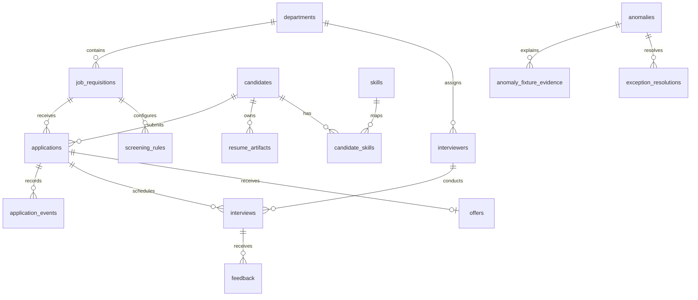

# Database schema

## Database contract

RecruitFlow uses SQLAlchemy models against MySQL 8. `Base.metadata.create_all()` is used by initialization, while [001_mysql_bootstrap.sql](../backend/database/migrations/001_mysql_bootstrap.sql) is the reference bootstrap script. The ORM model is the authoritative column definition in this codebase.

## Entity relationship diagram

## Tables and purpose

| Table | Purpose |
|---|---|
| departments | Organizational grouping |
| job_requisitions | Roles, openings, salary bands, and status |
| candidates | Candidate identity and experience |
| applications | Unique candidate/requisition submissions and stage |
| resume_artifacts | Private resume metadata and storage path |
| skills | Reusable skill vocabulary |
| candidate_skills | Candidate-to-skill association |
| screening_rules | Required/preferred skills per requisition |
| interviewers | Interviewer identity, department, and active flag |
| interviews | Scheduled interview windows and status |
| feedback | Structured interview ratings and recommendation |
| offers | Application offer, salary, approval, and release |
| application_events | Stage transition history |
| approval_history | Requisition and offer decisions |
| audit_logs | Actor/action/entity audit trail |
| anomalies | Ground-truth issue labels |
| anomaly_fixture_evidence | Exact records supporting labelled anomalies |
| users | Credentials, roles, lockout, and login state |
| exception_resolutions | Resolution history for anomaly issues |

## Constraints and indexes

- Primary keys are declared for every table; `candidate_skills` uses a composite key.
- `candidates.email`, `departments.name`, `skills.name`, `interviewers.email`, and `users.username` are unique.
- `applications(requisition_id, candidate_id)` is unique as `uq_application_pair`.
- `offers.application_id` is unique, allowing at most one offer per application.
- Foreign keys connect all lifecycle references to their parent rows.
- Frequently filtered foreign keys and statuses have indexes; interviews additionally use `ix_interview_window(interviewer_id, starts_at, ends_at)`.

The complete column-level contract is in [data_dictionary.md](data_dictionary.md).
