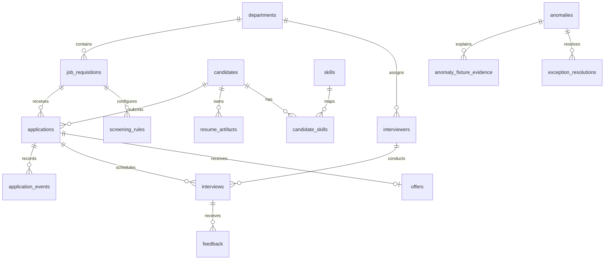

# Entity relationships

The diagram reflects the foreign keys in `backend/database/models.py`.

`approval_history`, `audit_logs`, and `users` use entity identifiers or actors
without database foreign keys to every possible business entity. The detailed
column contract is in [data_dictionary.md](data_dictionary.md).
