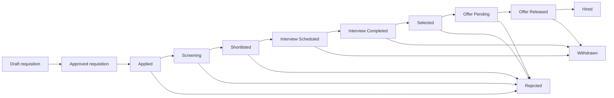

# Recruitment workflow

## End-to-end lifecycle

## Operational sequence

1. A requester creates a draft requisition with a salary band.
2. An approver changes it to `Approved`; the service checks the band and records the decision.
3. A candidate applies. The requisition must be approved and the requisition/candidate pair must be unused.
4. Screening evaluates the active rule and stores a score without changing the stage.
5. Authorized staff progress the application through valid transitions.
6. An active interviewer is booked for a non-overlapping window.
7. Completion is recorded, then structured feedback is submitted by the assigned interviewer.
8. A selected application receives an in-band offer.
9. An approver approves it, an authorized process owner releases it, and acceptance changes the application to `Hired`.

## Valid application transitions

| Current | Allowed next states |
|---|---|
| Applied | Screening, Withdrawn, Rejected |
| Screening | Shortlisted, Rejected, Withdrawn |
| Shortlisted | Interview Scheduled, Rejected, Withdrawn |
| Interview Scheduled | Interview Completed, Withdrawn |
| Interview Completed | Selected, Rejected, Withdrawn |
| Selected | Offer Pending, Rejected |
| Offer Pending | Offer Released, Rejected |
| Offer Released | Hired, Withdrawn |
| Hired, Rejected, Withdrawn | None |

The service requires interview feedback before `Interview Completed` or `Selected`. The anomaly fixture intentionally represents a completed interview without feedback outside the normal service path so the validator can inspect it.

## Related history

Every ordinary application transition adds an `ApplicationEvent` and `AuditLog`. Requisition and offer decisions add `ApprovalHistory`. Interview and offer operations add audit entries. This makes the current state and the path to that state independently inspectable.
