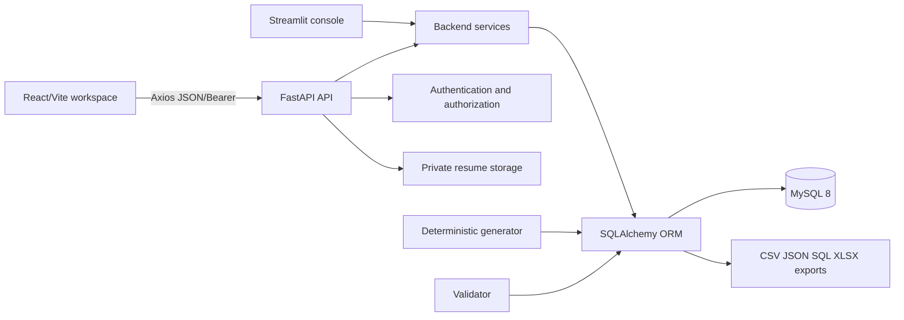
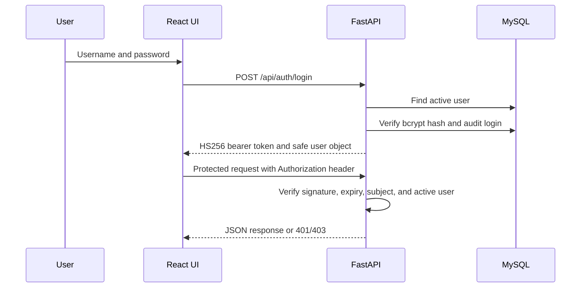

# System architecture

## Overview

## Responsibilities

| Layer | Responsibility |
|---|---|
| React/Vite | Routed workspaces, forms, tables, loading/error states, token storage, and API calls |
| FastAPI | HTTP contracts, Pydantic input validation, authentication dependencies, serialization, and status mapping |
| Services | Requisition, application, screening, interview, offer, and authentication rules |
| SQLAlchemy | Unit-of-work sessions, model mapping, schema creation, and MySQL access |
| MySQL | Durable entities, relationships, constraints, history, and indexes |
| Generator/validator | Synthetic data, exports, integrity checks, counts, lifecycle checks, and anomaly checks |

## Request lifecycle

1. The browser sends an HTTP request through `frontend/src/services/api.js`.
2. The API dependency creates a SQLAlchemy session and validates a Bearer token for protected routes.
3. Pydantic models validate structured request bodies.
4. A service checks permissions and business rules.
5. The service changes entities and adds event/audit/history rows, then commits.
6. The route serializes ORM columns to JSON. Session cleanup runs in the dependency finalizer.

The `/health` endpoint is unauthenticated. Login is the entry point for protected API use. Logout returns a stateless success response; client-side token removal is handled by the frontend.

## Authentication flow

## Important design decisions

- MySQL is required for runtime and tests; configuration fails closed for non-MySQL URLs.
- Services own workflow rules so API and Streamlit callers use the same decisions.
- Application events and audit logs are separate: events describe lifecycle state changes, while audit logs describe actor/action history.
- Anomaly evidence identifies intentional challenge conditions without weakening ordinary validation.
- The generator commits the destructive reset before population. Population is committed as one later transaction; a later export failure cannot undo that database commit.

## Data flow

Candidate and requisition data create an application. Screening reads the active requisition rule and candidate skills, interviews reference applications and interviewers, feedback references completed interviews, and offers reference applications. Analytics derives metrics from these relationships; it does not maintain a second metrics store.
